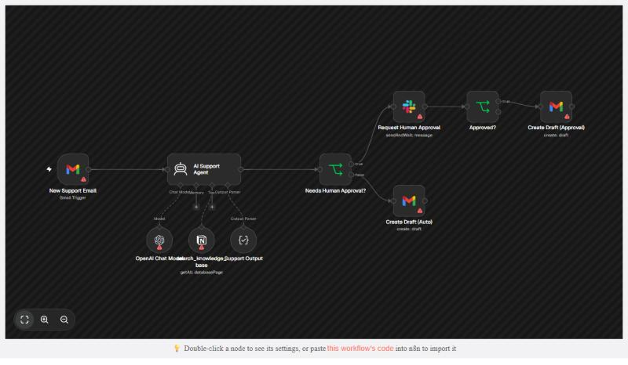

# AI Customer Support Agent

An n8n workflow that reads new support emails, looks up answers in a Notion knowledge base, drafts a reply with OpenAI, and saves it as a Gmail draft in the same thread. Risky or uncertain tickets go to Slack for a person to approve first.

Nothing is sent to customers automatically. Every reply ends up as a Gmail **draft** that you review and send.



*Rendered from the exported workflow file. The warning icons only mean no credentials are connected in this preview.*

## Flow

```
New Support Email (Gmail trigger, unread, every minute)
  -> AI Support Agent (OpenAI + search_knowledge_base Notion tool + structured output)
  -> Needs Human Approval?  (refund OR account_deletion OR confidence < 80)
       true  -> Request Human Approval (Slack, buttons: Create Gmail draft / Reject)
                -> Approved?
                     true -> Create Draft (Approval)
       false -> Create Draft (Auto)
```

## What each step does

| Node | Purpose |
|---|---|
| New Support Email | Polls Gmail every minute for unread emails |
| AI Support Agent | Searches the knowledge base, drafts a reply, and returns `category`, `confidence`, `draft_reply`, `summary` |
| OpenAI Chat Model | `gpt-5-mini` |
| search_knowledge_base | Notion tool: returns every article in your KB database |
| Support Output | JSON schema for the agent's answer (category limited to `refund`, `account_deletion`, `other`) |
| Needs Human Approval? | Sends refunds, account deletions and low-confidence replies to Slack |
| Request Human Approval | Posts the summary and draft to Slack and waits for a button click |
| Approved? | Creates the draft only if someone clicked **Create Gmail draft** |
| Create Draft (Approval / Auto) | Creates a Gmail draft reply in the original thread |

## Setup

### 1. Credentials (n8n > Credentials > Add credential)

| Credential | Used by | Notes |
|---|---|---|
| Gmail OAuth2 | New Support Email, both Create Draft nodes | Use the support inbox's Google account |
| OpenAI API | OpenAI Chat Model | Needs billing on your OpenAI account |
| Notion API (internal integration) | search_knowledge_base | Create the integration at notion.so/profile/integrations |
| Slack OAuth2 or Slack API (bot token) | Request Human Approval | The bot needs `chat:write`. Invite it to the channel with `/invite @YourBot` |

### 2. Notion knowledge base

Create a Notion database called **Support KB** with these properties:

| Property | Type | Example |
|---|---|---|
| Title | Title | How do I reset my password? |
| Keywords | Text | password, login, reset, locked out |
| Answer | Text | Go to Settings > Security > Reset password... |

Add one row per help article. Then open the database, click **... > Connections**, and add your integration. In the **search_knowledge_base** node, pick the database under **Data Source**.

The tool returns every article to the agent, which works well for up to about 100 articles. For a bigger KB, add a filter on the node.

### 3. Slack

Create a channel called `#support-approvals` (or change the channel in **Request Human Approval**) and invite the bot.

Approval buttons call back into n8n, so your n8n instance must be reachable from the internet. On n8n Cloud this already works. If you self-host, set `WEBHOOK_URL` to your public URL.

### 4. Test it

1. Open the workflow, click **Execute workflow**, then send a test email to the support inbox. Try three cases:
   - "How do I reset my password?" (with a matching KB article): goes straight to a Gmail draft
   - "I want a refund for last month": goes to Slack. Click **Create Gmail draft** and check Gmail Drafts
   - A question your KB doesn't cover: should come back with low confidence and go to Slack
2. Check that the draft is in the same Gmail thread and addressed to the sender.
3. When all three work, **Publish** (activate) the workflow.

## Tuning

- **Approval threshold:** change `80` in **Needs Human Approval?**.
- **Only some emails:** the trigger fires on *every* unread email, newsletters included. To limit it, open **New Support Email > Filters** and set a label (for example `support`) or a search such as `to:support@yourdomain.com`.
- **Rejected tickets:** nothing happens on Reject. Connect the `false` output of **Approved?** if you want a notification.

The agent is told to treat the email body as untrusted data, so a customer can't instruct it to skip approval.
