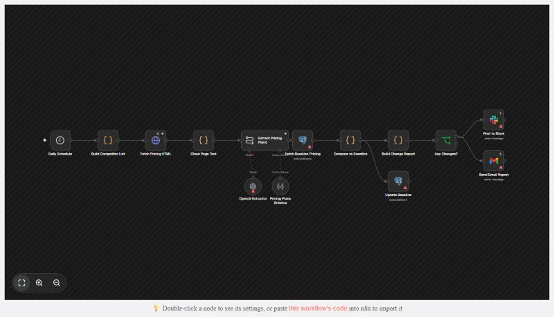

# Competitive Pricing Intelligence

An n8n workflow that checks competitor pricing pages every morning, uses OpenAI to extract their plans, compares them to the last saved snapshot in Postgres, and sends a Slack message and an email when something changed.



*Rendered from the exported workflow file. The warning icons only mean no credentials are connected in this preview.*

## Flow

```
Daily Schedule (08:00)
  -> Build Competitor List (Code: edit your competitors here)
  -> Fetch Pricing HTML (HTTP GET, 3 retries, keeps going on errors)
  -> Clean Page Text (strips scripts/markup, max 40k chars)
  -> Extract Pricing Plans (OpenAI + JSON schema)
  -> Fetch Baseline Pricing (Postgres: last saved plans)
  -> Compare vs Baseline (price increase/decrease, new plan, removed plan)
       -> Update Baseline (Postgres: save today's plans)
       -> Build Change Report
          -> Any Changes?
               true -> Post to Slack
                    -> Send Email Report (Gmail)
```

## What each step does

| Node | Purpose |
|---|---|
| Daily Schedule | Runs every day at 08:00 (workflow timezone) |
| Build Competitor List | The list of `{ name, url }` to check |
| Fetch Pricing HTML | Downloads each pricing page into `html` |
| Clean Page Text | Turns HTML into plain text to keep OpenAI costs down |
| Extract Pricing Plans | `gpt-5-mini` at temperature 0 returns `{ competitor, plans: [{ name, price, currency, billingPeriod, features }] }` |
| Fetch Baseline Pricing | Loads the saved plans for that competitor as a JSON array |
| Compare vs Baseline | Lists the changes. If nothing was extracted (page down, blocked), it skips that competitor instead of reporting every plan as removed |
| Update Baseline | Replaces the saved plans with today's. Skipped when nothing was extracted |
| Build Change Report | One combined report for all competitors. Stops here if nothing changed |
| Post to Slack / Send Email Report | Sends the report |

## Setup

### 1. Credentials (n8n > Credentials > Add credential)

| Credential | Used by |
|---|---|
| OpenAI API | OpenAI Extractor |
| Postgres | Fetch Baseline Pricing, Update Baseline |
| Slack (bot token or OAuth2, `chat:write`) | Post to Slack |
| Gmail OAuth2 | Send Email Report |

No Postgres yet? Free options: [Supabase](https://supabase.com) or [Neon](https://neon.tech). Use the connection details they give you (host, database, user, password, port 5432, SSL on).

### 2. Database table

Run [`schema.sql`](schema.sql) once in your database (the Supabase/Neon SQL editor works, or `psql -f schema.sql`).

### 3. Edit the workflow

1. **Build Competitor List:** replace the example competitors with real pricing page URLs.
2. **Post to Slack:** set the channel (default `#competitive-intel`) and invite the bot to it.
3. **Send Email Report:** replace the recipient placeholder with your email address.
4. Workflow **Settings > Timezone:** set yours so 08:00 is your local time.

### 4. Test it

1. Click **Execute workflow**. The baseline table starts empty, so the first run reports every plan as `new_plan`. That is expected.
2. Check that the `competitor_pricing` table now has rows, and that Slack and email got the report.
3. Run it again. Nothing should change, so no message is sent and the run stops at **Build Change Report**.
4. To test a change alert, edit a price in the table (`UPDATE competitor_pricing SET price = 1 WHERE plan_name = 'Pro';`) and run again.
5. When it works, **Publish** (activate) the workflow.

## Notes

- Pages that build their prices with JavaScript, or that block bots (Cloudflare), come back empty. That competitor is skipped and nothing is overwritten. Open **Clean Page Text** output to check what the model saw. For those sites, point the URL at a scraping service such as ScrapingBee or Firecrawl.
- Plans are matched by name. If a competitor renames a plan, it shows up as one removed plan and one new plan.
